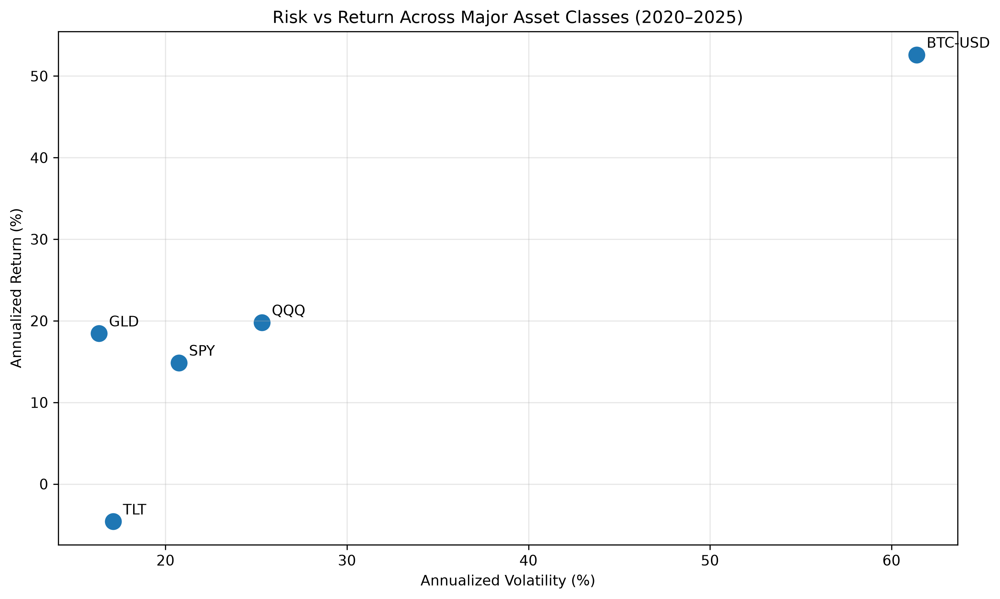
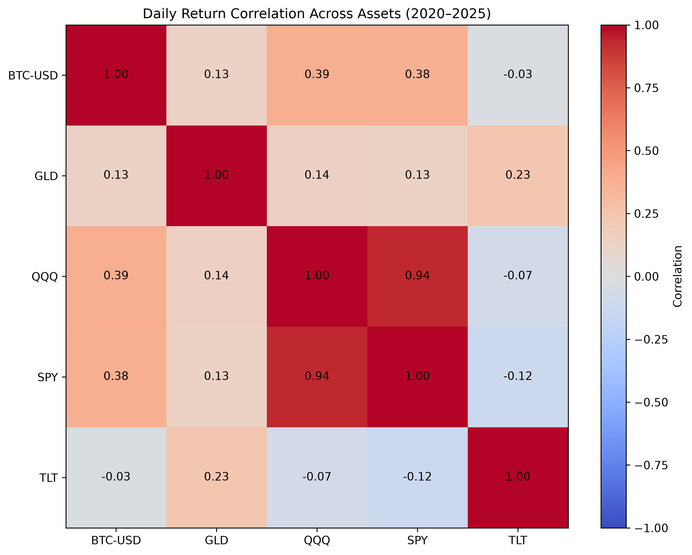
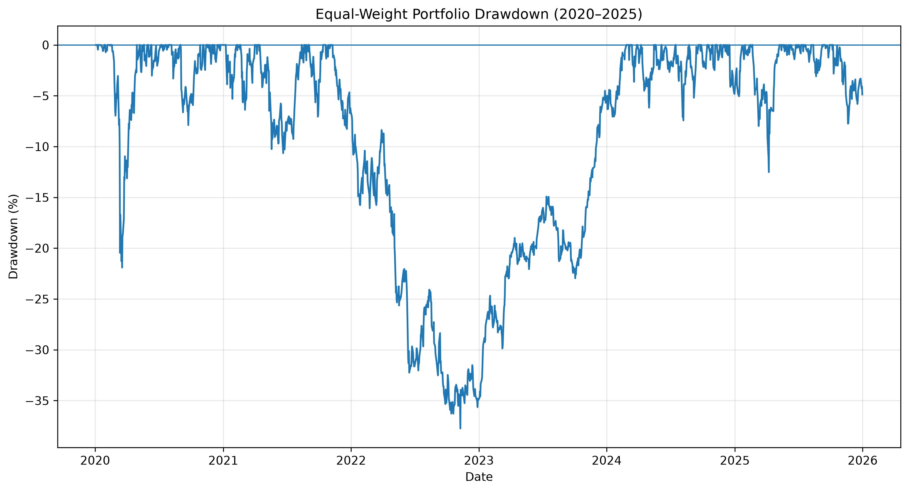
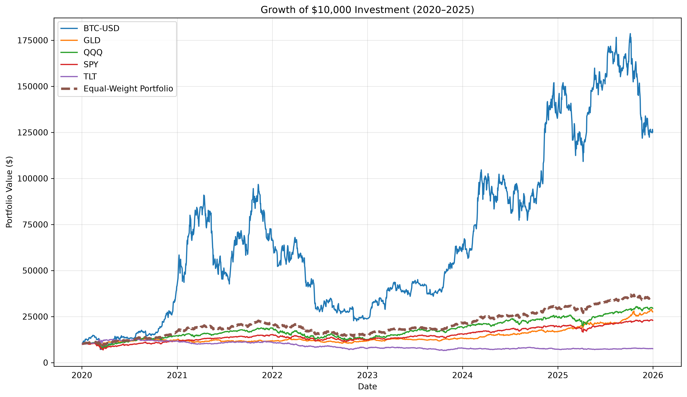
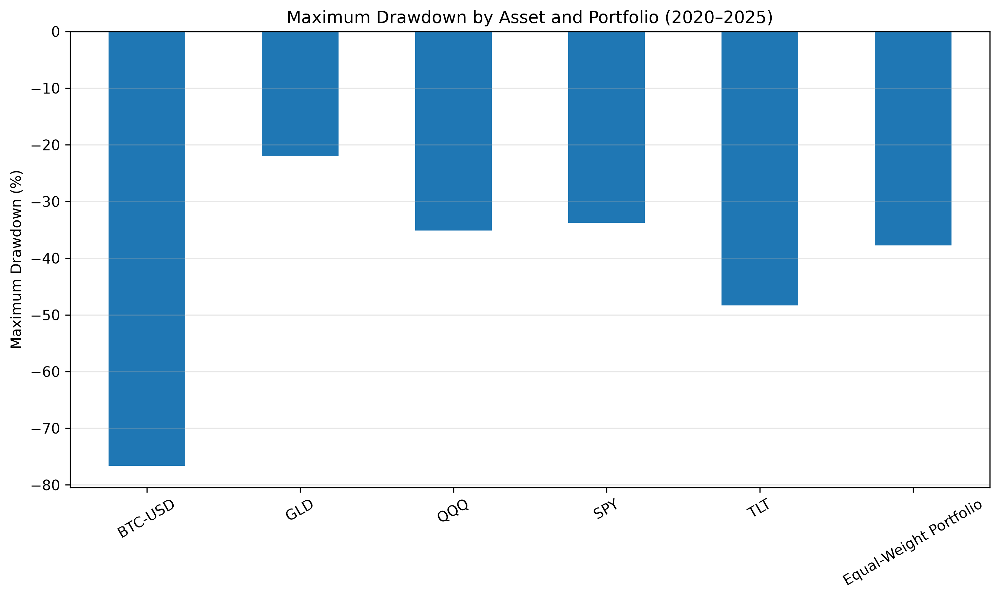

# Financial Markets & Portfolio Risk Analysis

## Project Overview

This project uses Python to analyze the historical performance, risk, and diversification characteristics of five major financial assets from 2020–2025.

The analysis compares equities, bonds, gold, and cryptocurrency using return, volatility, correlation, drawdown, and risk-adjusted performance metrics. An equal-weight portfolio is also constructed to evaluate the historical effects of diversification.

## Assets Analyzed

| Ticker | Asset |
|---|---|
| SPY | U.S. Large-Cap Equities |
| QQQ | Nasdaq-100 / Growth Equities |
| TLT | Long-Term U.S. Treasury Bonds |
| GLD | Gold |
| BTC-USD | Bitcoin |

## Tools & Libraries

- Python
- Pandas
- NumPy
- Matplotlib
- yfinance
- Jupyter Notebook

## Analysis

The project covers:

- Historical market data collection and preparation
- Daily return calculation
- Annualized return and volatility
- Risk-return comparison
- Cross-asset correlation analysis
- Equal-weight portfolio construction
- Maximum drawdown analysis
- Sharpe ratio analysis
- Growth of a hypothetical USD 10,000 investment

## Risk vs Return



Bitcoin generated the highest historical annualized return but also exhibited substantially greater volatility. Gold produced a comparatively strong return with lower volatility during the sample period.

## Correlation & Diversification



SPY and QQQ exhibited a correlation of **0.94**, indicating substantial overlap in their historical return movements. Gold and long-term Treasuries showed considerably weaker relationships with the equity assets.

## Equal-Weight Portfolio

An equal-weight portfolio was constructed with **20% allocated to each asset**.

| Metric | Result |
|---|---:|
| Annualized Return | 23.32% |
| Annualized Volatility | 18.89% |
| Sharpe Ratio | 1.23 |
| Maximum Drawdown | -37.74% |

The portfolio achieved the highest historical Sharpe ratio in the analysis under the assumed 0% risk-free rate.

## Portfolio Drawdown



The equal-weight portfolio experienced a maximum peak-to-trough decline of **37.74%**, demonstrating that diversification can alter portfolio risk without eliminating substantial downside exposure.

## Growth of USD 10,000



A hypothetical USD 10,000 investment produced substantially different wealth paths across the assets.

Bitcoin generated the highest ending value at approximately **USD 125,272.64**, while the equal-weight portfolio grew to approximately **USD 35,028.10**. Bitcoin's higher ending value was accompanied by substantially greater volatility and drawdown risk.

## Maximum Drawdown Comparison



| Asset | Maximum Drawdown |
|---|---:|
| BTC-USD | -76.63% |
| GLD | -22.00% |
| QQQ | -35.12% |
| SPY | -33.72% |
| TLT | -48.35% |
| Equal-Weight Portfolio | -37.74% |

Gold recorded the smallest maximum drawdown in the sample, while Bitcoin experienced the largest.

## Key Findings

- Bitcoin delivered the highest historical return but also the greatest volatility and maximum drawdown.
- SPY and QQQ were highly correlated, limiting the diversification obtained by combining the two equity ETFs.
- Gold exhibited relatively weak correlations with the other assets and the smallest maximum drawdown.
- The equal-weight portfolio generated a **23.32% annualized return** with **18.89% annualized volatility**.
- Under a 0% risk-free-rate assumption, the equal-weight portfolio achieved the highest Sharpe ratio at **1.23**.
- Diversification improved historical risk-adjusted performance in this sample but did not eliminate significant downside risk.

## Methodology Notes & Limitations

- Historical market data covers **2020–2025**.
- Prices were retrieved using the `yfinance` Python package.
- Daily observations were aligned across assets before calculating returns.
- Annualization assumes approximately **252 trading days per year**.
- Sharpe ratios assume a **0% risk-free rate**.
- The portfolio uses fixed equal weights rather than optimized weights.
- Transaction costs, taxes, fees, inflation, and trading constraints are excluded.
- Historical results do not predict future investment performance.

## Repository Structure

```text
Financial-Markets-Python-Analysis/
│
├── README.md
├── financial_markets_analysis.ipynb
│
└── charts/
    ├── risk_return.png
    ├── correlation_matrix.png
    ├── portfolio_drawdown.png
    ├── investment_growth.png
    └── maximum_drawdown.png
```

## Author

**Ian Mark Esipisu**

Data Analytics | Python | SQL | Financial Engineering | Research

---

*This project is intended for educational and portfolio demonstration purposes and does not constitute investment advice.*
